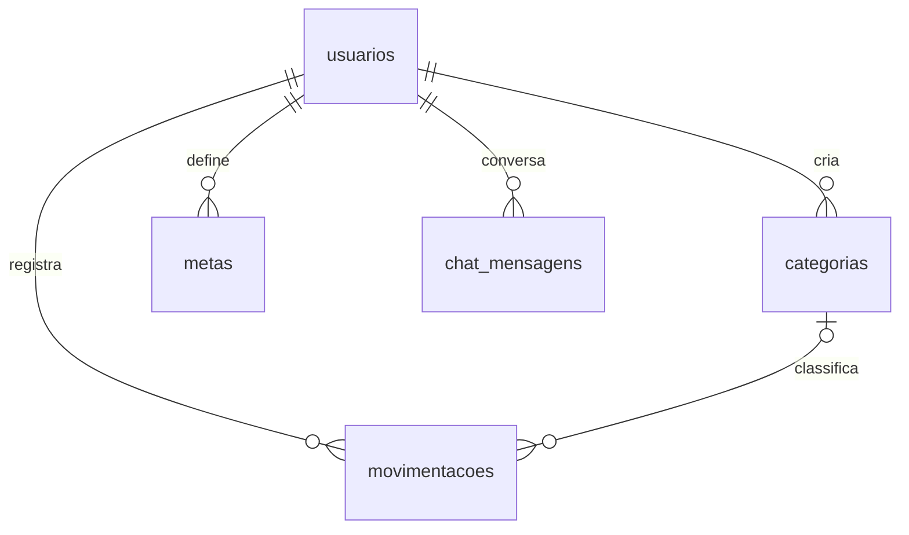

# FinLog — Modelo de dados

Documentação do banco de dados do FinLog. A versão para leitura e impressão é o `docs/DADOS.pdf`; este arquivo é a fonte editável em texto. O diagrama entidade-relacionamento editável está em `docs/modelo-de-dados.mmd` (Mermaid) e o PDF é gerado por `docs/fontes/gerar_dados_pdf.py`.

## 1. Visão geral

| Item | Valor |
|---|---|
| Banco de dados | MySQL 9.7 (imagem `mysql:9.7` em `api/docker-compose.yml`) |
| Nome do banco | `finlog_db` (padrão de `FINLOG_DB_URL` e `MYSQL_DATABASE`) |
| Acesso aos dados | Spring Data JPA com Hibernate ORM 7.2 (dialeto `MySQLDialect`) |
| Criação do esquema | Automática pelo Hibernate: `spring.jpa.hibernate.ddl-auto=update` (variável `JPA_DDL_AUTO`) |
| Scripts SQL / migrações | Não há. O projeto não tem arquivos `.sql`, Flyway nem Liquibase |
| Tabelas | `usuarios`, `categorias`, `movimentacoes`, `metas`, `chat_mensagens` |
| Entidades JPA | `api/src/main/java/com/ucb/finlog/model/` |
| Repositórios | `api/src/main/java/com/ucb/finlog/repository/` |

O FinLog guarda os dados financeiros de cada usuário: as **movimentações** (receitas e despesas), as **categorias** que as classificam, as **metas** de economia e as **mensagens da conversa com a IA**. Todo registro pertence a um único usuário, e as consultas sempre filtram pelo usuário autenticado (seção 6).

### Como o esquema é criado

Não existe script SQL de criação. Ao iniciar, a API lê as classes anotadas com `@Entity` e o Hibernate cria no MySQL as tabelas, colunas, chaves e restrições que ainda não existem (`ddl-auto=update`). A URL de conexão tem `createDatabaseIfNotExist=true`, então o próprio banco `finlog_db` também é criado se faltar.

- Os nomes dos atributos Java em camelCase viram colunas em snake_case (por exemplo, `tokenVersion` → `token_version` e `criadaEm` → `criada_em`).
- Os tipos MySQL desta documentação foram conferidos com `SHOW CREATE TABLE` em um banco vazio criado pela versão atual da API.
- O `update` só **acrescenta** o que falta: não remove colunas e não muda colunas que já existem. Um banco criado por uma versão anterior pode ficar diferente do mapeamento atual (por exemplo, com uma coluna aceitando `NULL`). Para recriar o banco do Docker do zero, use `docker compose down -v` dentro de `api/`. Esse comando **apaga todos os dados** do volume `mysql_finlog`.
- As tabelas usam InnoDB com `utf8mb4` e a collation `utf8mb4_0900_ai_ci`, que é o padrão do MySQL 9.7 (nada disso é configurado no projeto). Essa collation compara textos sem diferenciar maiúsculas, minúsculas e acentos.

## 2. Diagrama entidade-relacionamento

Notação "pé de galinha": `||` = exatamente um, `|o` = zero ou um, `o{` = zero ou muitos.



Os atributos de cada tabela estão no arquivo `docs/modelo-de-dados.mmd` e no diagrama do `DADOS.pdf`.

## 3. Tabelas

Legenda: **PK** = chave primária, **FK** = chave estrangeira, **UK** = valor único. Todas as chaves primárias são `bigint` geradas pelo próprio MySQL (`AUTO_INCREMENT`, mapeado como `GenerationType.IDENTITY`).

### 3.1 `usuarios` (entidade `Usuario`)

Pessoas cadastradas no sistema. É a tabela central: todas as outras apontam para ela.

| Coluna | Atributo Java | Tipo Java | Tipo MySQL | Nulo | Restrições |
|---|---|---|---|---|---|
| `id` | `id` | `Long` | `bigint` | não | PK, `AUTO_INCREMENT` |
| `nome` | `nome` | `String` | `varchar(255)` | não | |
| `email` | `email` | `String` | `varchar(255)` | não | UK (único) |
| `senha` | `senha` | `String` | `varchar(255)` | não | guarda o hash BCrypt, não a senha |
| `token_version` | `tokenVersion` | `int` | `int` | não | `DEFAULT 0` (`@ColumnDefault("0")`) |

- **Relacionamentos:** `@OneToMany(mappedBy = "usuario")` para `Movimentacao` (lista `movimentacoes`, carregamento LAZY, sem cascata). Não há coleção mapeada para categorias, metas ou mensagens: essas ligações só existem do lado do filho.
- O e-mail é gravado sem espaços nas pontas e em minúsculas (`UsuarioService.cadastrar`). O login normaliza o e-mail da mesma forma antes de buscar.
- A senha é cifrada com `BCryptPasswordEncoder` (`SecurityConfig`). O cadastro aceita senhas de 6 a 72 caracteres.
- `token_version` entra no token de acesso. No logout ela é incrementada, o que invalida todos os tokens emitidos antes (`AuthService.logout` e `AuthTokenFilter`).
- `senha`, `tokenVersion` e `movimentacoes` têm `@JsonIgnore` e nunca saem nas respostas da API.
- Validação na entrada (`CadastroUsuarioRequest`): nome obrigatório com até 100 caracteres; e-mail obrigatório, em formato válido, com até 255 caracteres.

### 3.2 `categorias` (entidade `Categoria`)

Categorias criadas por cada usuário para classificar as movimentações (por exemplo, "Mercado" ou "Salário").

| Coluna | Atributo Java | Tipo Java | Tipo MySQL | Nulo | Restrições |
|---|---|---|---|---|---|
| `id` | `id` | `Long` | `bigint` | não | PK, `AUTO_INCREMENT` |
| `nome` | `nome` | `String` | `varchar(100)` | não | UK junto com `usuario_id` |
| `descricao` | `descricao` | `String` | `varchar(255)` | sim | |
| `usuario_id` | `usuario` | `Usuario` | `bigint` | não | FK → `usuarios.id` |

- **Restrição única `uk_categoria_usuario_nome` (`usuario_id`, `nome`):** o mesmo usuário não pode ter duas categorias com o mesmo nome. Usuários diferentes podem repetir nomes.
- **Relacionamento:** `@ManyToOne(fetch = LAZY)` com `Usuario`, obrigatório (N categorias para 1 usuário).
- Antes de gravar, o serviço tira os espaços das pontas do nome e recusa um nome que já exista para o usuário, sem diferenciar maiúsculas de minúsculas (`existsByNomeIgnoreCaseAndUsuarioEmail`). Nesse caso a API responde 409.
- Uma categoria não pode ser excluída enquanto tiver movimentações: `CategoriaService.deletar` responde 409 ("Categoria possui movimentacoes"). A chave estrangeira em `movimentacoes.categoria_id` também impediria a exclusão.
- Uma categoria também é criada automaticamente quando uma movimentação é salva com um nome de categoria que o usuário ainda não tem (`MovimentacaoService.resolverCategoria`).
- Os totais de cada categoria (receitas, despesas e saldo) não ficam gravados: são calculados a cada consulta a partir das movimentações (`somarPorCategoriaETipo`).

### 3.3 `movimentacoes` (entidade `Movimentacao`)

Lançamentos financeiros do usuário: cada linha é uma receita ou uma despesa.

| Coluna | Atributo Java | Tipo Java | Tipo MySQL | Nulo | Restrições |
|---|---|---|---|---|---|
| `id` | `id` | `Long` | `bigint` | não | PK, `AUTO_INCREMENT` |
| `descricao` | `descricao` | `String` | `varchar(255)` | sim | |
| `valor` | `valor` | `BigDecimal` | `decimal(15,2)` | não | `precision = 15, scale = 2` |
| `data` | `data` | `LocalDate` | `date` | não | |
| `tipo` | `tipo` | `TipoMovimentacao` | `enum('DESPESA','RECEITA')` | não | `@Enumerated(STRING)` |
| `usuario_id` | `usuario` | `Usuario` | `bigint` | não | FK → `usuarios.id` |
| `categoria_id` | `categoria` | `Categoria` | `bigint` | sim | FK → `categorias.id` |

- **Relacionamentos:**
  - `@ManyToOne(fetch = LAZY)` com `Usuario`, obrigatório (N movimentações para 1 usuário).
  - `@ManyToOne` com `Categoria`, **opcional**: a movimentação pode ficar sem categoria. Sem `fetch` declarado, vale o padrão do JPA para `@ManyToOne`, que é EAGER. A resposta da API (`MovimentacaoResponse`) inclui a categoria.
- O valor é gravado sempre positivo. É o `tipo` que diz se a movimentação entra (RECEITA) ou sai (DESPESA) do saldo. A entrada (`MovimentacaoRequest`) exige valor positivo, com até 13 dígitos inteiros e 2 decimais (cabe em `decimal(15,2)`), data e tipo obrigatórios, e descrição de até 255 caracteres.
- A categoria pode ser informada pelo `categoriaId` (precisa ser do mesmo usuário; senão a API responde 404) ou pelo nome. Pelo nome, a API reaproveita a categoria do usuário com esse nome, sem diferenciar maiúsculas de minúsculas, ou cria uma nova. Um nome vazio deixa a movimentação sem categoria.

### 3.4 `metas` (entidade `Meta`)

Metas financeiras do usuário: um objetivo com um valor a alcançar.

| Coluna | Atributo Java | Tipo Java | Tipo MySQL | Nulo | Restrições |
|---|---|---|---|---|---|
| `id` | `id` | `Long` | `bigint` | não | PK, `AUTO_INCREMENT` |
| `descricao` | `descricao` | `String` | `varchar(255)` | não | |
| `valor` | `valor` | `BigDecimal` | `decimal(15,2)` | não | `precision = 15, scale = 2` |
| `usuario_id` | `usuario` | `Usuario` | `bigint` | não | FK → `usuarios.id` |

- **Relacionamento:** `@ManyToOne(fetch = LAZY)` com `Usuario`, obrigatório (N metas para 1 usuário).
- Entrada (`MetaRequest`): descrição obrigatória com até 255 caracteres (gravada sem espaços nas pontas) e valor positivo com até 13 dígitos inteiros e 2 decimais.
- A tabela guarda só a descrição e o valor-alvo. O quanto falta para cada meta não é gravado. Para o contexto enviado à IA, `AIService.descreverMetas` calcula, meta por meta, o valor da meta menos o saldo atual das movimentações (saldo negativo conta como zero).

### 3.5 `chat_mensagens` (entidade `ChatMensagem`)

Mensagens da conversa do usuário com o assistente de IA. Valem só durante a sessão.

| Coluna | Atributo Java | Tipo Java | Tipo MySQL | Nulo | Restrições |
|---|---|---|---|---|---|
| `id` | `id` | `Long` | `bigint` | não | PK, `AUTO_INCREMENT` |
| `papel` | `papel` | `PapelMensagem` | `enum('IA','USUARIO')` | não | `@Enumerated(STRING)`, `length = 10` |
| `texto` | `texto` | `String` | `varchar(4000)` | não | `length = TAMANHO_MAXIMO_TEXTO` (4000) |
| `criada_em` | `criadaEm` | `Instant` | `datetime(6)` | não | data e hora com microssegundos |
| `usuario_id` | `usuario` | `Usuario` | `bigint` | não | FK → `usuarios.id` |

- **Relacionamento:** `@ManyToOne(fetch = LAZY)` com `Usuario`, obrigatório (N mensagens para 1 usuário).
- Cada pergunta respondida gera duas linhas: a do usuário (`USUARIO`) e a resposta (`IA`) (`AIService.salvarTroca`). Se a IA não responder, nada é gravado.
- Textos maiores que 4000 caracteres são cortados antes de gravar. A pergunta do usuário é limitada a 500 caracteres na entrada (`ChatRequest`).
- As últimas 10 mensagens (`findTop10ByUsuarioEmailOrderByIdDesc`) vão junto como histórico para a IA lembrar da conversa.
- **Ciclo de vida:** todas as mensagens do usuário são apagadas no login e no logout (`deleteByUsuarioId` em `AuthService`). Cada sessão começa com uma conversa nova.

## 4. Enumerações

Os dois enums são gravados pelo **nome** (`EnumType.STRING`), e não pela posição. Por isso, mudar a ordem das constantes no Java não altera os dados. No MySQL o Hibernate cria uma coluna do tipo `enum` nativo com os nomes em ordem alfabética.

| Enum (Java) | Coluna | Valores | Significado |
|---|---|---|---|
| `TipoMovimentacao` | `movimentacoes.tipo` | `RECEITA` | entrada de dinheiro (soma no saldo) |
| | | `DESPESA` | saída de dinheiro (subtrai do saldo) |
| `PapelMensagem` | `chat_mensagens.papel` | `USUARIO` | mensagem escrita pelo usuário |
| | | `IA` | resposta gerada pelo assistente de IA |

Para incluir um valor novo num enum, é preciso ajustar a coluna no banco, porque o `ddl-auto=update` não altera colunas que já existem.

## 5. Relacionamentos

| Origem (N) | Destino (1) | Chave estrangeira | Cardinalidade | Obrigatório | Carregamento |
|---|---|---|---|---|---|
| `categorias` | `usuarios` | `categorias.usuario_id` | N : 1 | sim | LAZY |
| `movimentacoes` | `usuarios` | `movimentacoes.usuario_id` | N : 1 | sim | LAZY |
| `movimentacoes` | `categorias` | `movimentacoes.categoria_id` | N : 0..1 | não | EAGER (padrão) |
| `metas` | `usuarios` | `metas.usuario_id` | N : 1 | sim | LAZY |
| `chat_mensagens` | `usuarios` | `chat_mensagens.usuario_id` | N : 1 | sim | LAZY |

- Nenhum relacionamento tem `cascade` nem `orphanRemoval`. As chaves estrangeiras são criadas sem `ON DELETE`, então o MySQL bloqueia a exclusão de uma linha que ainda é referenciada.
- O lado inverso só está mapeado em `Usuario.movimentacoes` (`mappedBy = "usuario"`), usado apenas pelo JPA e escondido do JSON.
- A API não tem rota para excluir usuários.

## 6. Isolamento dos dados por usuário

Cada usuário só enxerga e altera os próprios registros. A regra fica nas consultas dos repositórios e não depende do que o cliente envia:

1. O `AuthTokenFilter` valida o token, busca o usuário pelo `id` gravado no token, confere a `token_version` e coloca no contexto um `UsuarioAutenticado(id, email)`.
2. Os controllers recebem esse usuário com `@AuthenticationPrincipal` e passam o e-mail dele aos serviços. O `id` do usuário nunca vem do corpo da requisição.
3. Toda consulta dos repositórios filtra pelo e-mail do dono (`...AndUsuarioEmail` / `findByUsuarioEmail...`), o que gera um `JOIN` com `usuarios` e um `WHERE usuarios.email = ?`:

| Repositório | Consulta | O que garante |
|---|---|---|
| `MovimentacaoRepository` | `findByUsuarioEmail` | lista só as movimentações do usuário |
| | `findByIdAndUsuarioEmail` | buscar, editar ou excluir por id só acha registro do próprio usuário (senão 404) |
| | `findByCategoriaIdAndUsuarioEmail`, `existsByCategoriaIdAndUsuarioEmail` | movimentações de uma categoria, só do usuário |
| | `somarPorCategoriaETipo` (JPQL) | soma `valor` por categoria e tipo com `where m.usuario.email = :email` |
| `CategoriaRepository` | `findByUsuarioEmailOrderByNomeAsc` | lista as categorias do usuário em ordem alfabética |
| | `findByIdAndUsuarioEmail` | impede usar ou alterar a categoria de outro usuário (404) |
| | `findByNomeIgnoreCaseAndUsuarioEmail`, `existsByNomeIgnoreCaseAndUsuarioEmail` | procura nomes repetidos só entre as categorias do usuário |
| `MetaRepository` | `findByUsuarioEmailOrderByIdAsc`, `findByIdAndUsuarioEmail` | lista e altera só as metas do usuário |
| `ChatMensagemRepository` | `findByUsuarioEmailOrderByIdAsc`, `findTop10ByUsuarioEmailOrderByIdDesc` | histórico da conversa só do usuário |
| | `deleteByUsuarioId` | apaga só as mensagens do usuário que entrou ou saiu |
| `UsuarioRepository` | `findByEmail`, `existsByEmail` | localiza o dono e impede e-mail duplicado no cadastro |

Quando um registro existe mas pertence a outro usuário, a API responde **404 (não encontrado)** em vez de 403. Assim ela nem revela que o registro existe. Ao criar registros, o serviço liga o novo registro ao usuário autenticado (`setUsuario`), sem ler nenhum dono enviado pelo cliente.

## 7. Como conferir o esquema e regenerar este documento

Com a API e o MySQL rodando pelo `docker compose`, estes comandos, executados na pasta `api/` em um terminal Bash (Git Bash, Linux ou macOS), listam as tabelas e mostram o DDL que o Hibernate criou:

```bash
docker compose exec mysql-db sh -c 'mysql -uroot -p"$MYSQL_ROOT_PASSWORD" "$MYSQL_DATABASE" -e "SHOW TABLES;"'
docker compose exec mysql-db sh -c 'mysql -uroot -p"$MYSQL_ROOT_PASSWORD" "$MYSQL_DATABASE" -E -e "SHOW CREATE TABLE movimentacoes;"'
```

Para gerar o PDF de novo depois de editar o conteúdo: `python docs/fontes/gerar_dados_pdf.py`. O script precisa do `reportlab` e usa as fontes do Windows.
